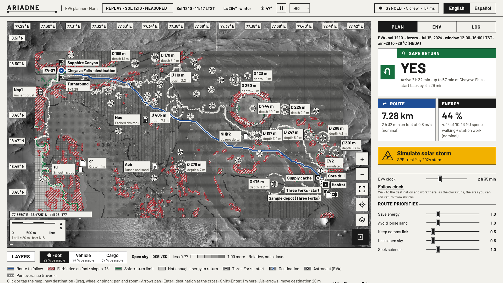
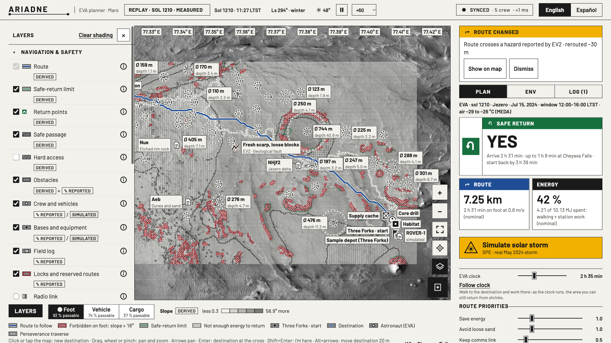
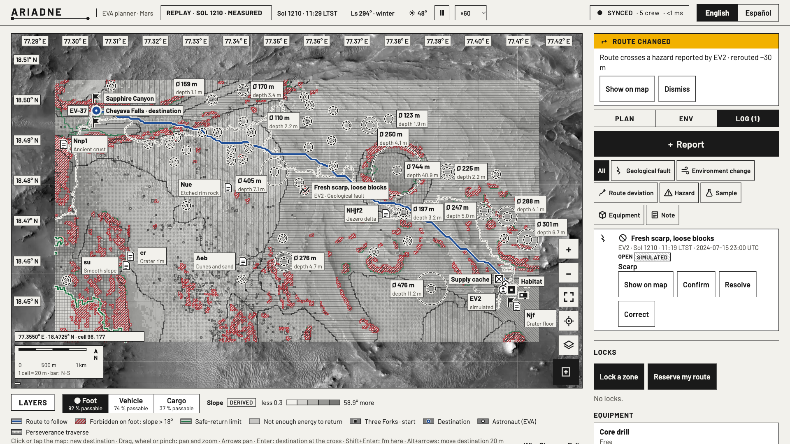
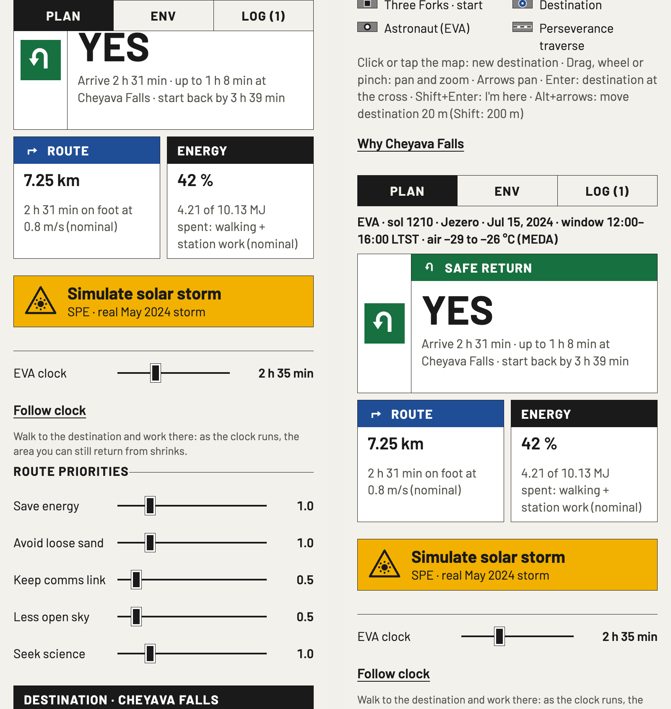
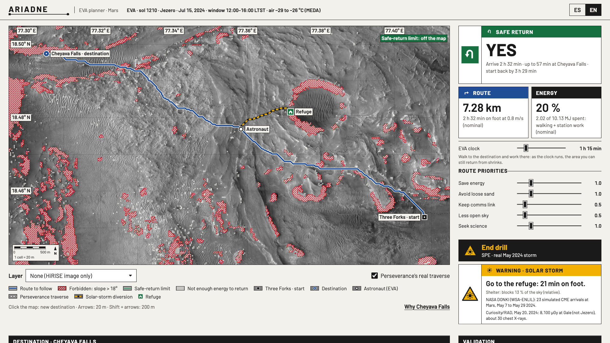

# ARIADNE

**EN** · [ES](#español)

> A field network for the spacewalk: where do we walk, can we get back, and what do we do if a storm arrives. Several devices, one shared plan, no internet.



| | |
|---|---|
|  |  |
|  |  |

Entry for NASA Space Apps 2026, *Mars Surface Exploration Map*. ARIADNE is not affiliated with or endorsed by NASA.

## Concept

A signal takes 3 to 22 minutes between Mars and Earth, so a crew on a spacewalk (EVA) decides alone. ARIADNE is the offline guide, route and log tool they would carry:

1. **Route.** The walking route with the least energy for a person in a suit at 0.38 g (Pandolf), around steep slopes, loose sand and large rocks, with a **safe-return limit** that shrinks as the EVA clock runs.
2. **Field network.** Phones, tablets and a laptop on the same Wi-Fi share one plan through a central **hub**: ordered updates, leased locks ("bloqueos") on zones and equipment, an append-only field log (fault, hazard, route deviation, sample, equipment...) that **changes other devices' routes**, crew positions and measured latency. If the hub drops, devices keep working and catch up.
3. **Environment.** A Mars clock (NASA GISS Mars24) that replays a real MEDA sol or runs on any date, with 36 layers in 6 categories (navigation, topography, geology, meteorology, atmosphere, radiation) and a dust-storm hazard. Every value is tagged `MEASURED`, `DERIVED`, `MODEL`, `SIMULATED` or `REPORTED`.

On Mars the hub would be the habitat and the sensors (weather, dosimeter, seismometer, orbiter relay) would feed it; in the demo the hub is a laptop and the sensors are replayed or simulated.

## Zone

Jezero crater, 7.1 x 3.9 km (lon 77.295 to 77.415, lat 18.440 to 18.505), a 193 x 356 grid of 20 m cells. The default EVA goes from the *Three Forks* sample depot to *Cheyava Falls*, where Perseverance found a potential biosignature (not confirmed life): 7.28 km, 2 h 32 min on foot. Basemap: NASA HiRISE 25 cm tiles cached offline.

## Objectives (what the challenge asks, what ARIADNE does)

| Challenge | ARIADNE |
|---|---|
| Layered, integrated view of a route or place | Offline Leaflet map, 36 layers in 6 categories, passage profiles for foot, vehicle and delicate cargo |
| At least three kinds of data | Optical (HiRISE), topography (DTM), thermal (THEMIS), minerals (CRISM), geology (USGS), atmosphere (MEDA), radiation and space weather (RAD, DONKI) |
| Astronaut safety, space weather, radiation | Solar-storm drill, dust-storm hazard marker, radiation layers with crew-protection info, safe-return limit |
| Obstacle-avoiding route, mobility with load | Slopes over 18 degrees forbidden, loose sand and large rocks avoided, Pandolf energy with an 80 kg crew member and 50 kg load |
| Imagery of the destination | Real Perseverance photos at Cheyava Falls, credited |

## Quick start

Needs Node 20+ (and Python 3 for `make serve`). `make help` lists everything:

```text
make up            install, test and start the hub (app + LAN sync + QR)   -> http://localhost:8090
make hub           start the hub only (TOKEN=secret protects the Base role)
make sim           hub + simulated crew, rover and dust storm (SIM=storm_eva)
make serve         app only on :8000, solo mode, no sync
make test          138 Node tests, about 15 s
make apk           build the debug Android APK (JDK 21 + Android SDK)
make data          rebuild data from NASA sources (needs network)
make tiles         download the HiRISE tiles z13 to z17
make clean         remove local envs and build outputs
make fclean        clean + downloads, tiles and caches (then: make data tiles)
```

Join from phones: `make hub` prints a QR and the laptop's LAN address; scan it on the same Wi-Fi or hotspot. The page is English by default; use the `EN | ES` switch in the header (or `?lang=es`).

## Simulation mode

One laptop can demo the whole multi-device story. `make sim` runs a scenario that fakes other astronauts, a rover, supplies, a weather change and a dust storm, all tagged `SIMULATED`:

1. `make sim`
2. Open `http://localhost:8090/?crew=EV1` and, side by side, `http://localhost:8090/?crew=BASE&role=base`.
3. Watch EV2 (simulated) report a fault on the route and both windows reroute; lock a zone in one window and see it in the other with the latency; see WARNING during the afternoon wind, then the dust storm jump straight to DANGER and the NO-GO panel.

Without a hub (for example a static copy), `?sim=storm_eva` runs the same scenario inside one window.

## Android

Debug APK built by GitHub Actions on every push (workflow artifact `ariadne-debug-apk`); published to the **Releases** page as `apk-latest` (`ariadne-debug.apk`) from `main` and for `v*` tags. Locally: install JDK 21 and the Android cmdline-tools (`brew install openjdk@21 && brew install --cask android-commandlinetools` on macOS, `jdk21-openjdk` + Android Studio's SDK on Linux), then `make apk` (output `android/app/build/outputs/apk/debug/app-debug.apk`, install with `adb install -r`). In the app, tap the sync chip and enter the hub's `ip:port`.

## APIs and data used

Everything is fetched ahead of time and committed; the running app makes no network calls except the WebSocket to your own hub. Keys: only DONKI needs one, `NASA_API_KEY` in `app/.env` (git-ignored; `DEMO_KEY` otherwise).

| Source | Main call | For |
|---|---|---|
| NASA Mars Trek WMTS | `trek.nasa.gov/tiles/Mars/EQ/JEZ_hirise_soc_006_orthoMosaic_25cm_.../1.0.0/default/default028mm/{z}/{row}/{col}.png` | Offline HiRISE basemap |
| USGS Astrogeology HiRISE DTM and THEMIS (Astropedia) | HTTP range read of GeoTIFF/cube windows with `rasterio` | Elevation, slope, relief, thermal inertia |
| USGS SIM 3464 (ArcGIS FeatureServer) | `.../Jezero_FeatureServiceFromPro/FeatureServer/8/query?f=geojson` | Geologic units |
| Zenodo CRISM | `zenodo.org/api/records/5575824/files/jezeroFinal.tif/content` | Minerals, science score |
| Mars 2020 MMGIS | `mars.nasa.gov/mmgis-maps/M20/Layers/json/M20_waypoints.json` | Perseverance traverse, validation |
| NASA DONKI (api.nasa.gov) | `api.nasa.gov/DONKI/WSAEnlilSimulations?startDate=...&endDate=...&api_key=` | CME arrivals at Mars, May 2024 |
| PDS Atmospheres Node, MEDA | CSV under `atmos.nmsu.edu/PDS/data/PDS4/Mars2020/mars2020_meda/` | Pressure, temperature, humidity, wind for 14 sols |
| NASA Images API / Photojournal | `images-api.nasa.gov/search?nasa_id=PIA26369` | Destination photos |
| NASA GISS Mars24 | algorithm, no call | Mars clock |

Limits: radiation shown in the plan is relative; the 8,100 uGy dose was measured at Gale, not Jezero; suit parameters are nominal; the geologic map is regional and pre-landing.

## Build, test, deploy

- **Test:** `make test` (unit tests for the engine, Mars24, environment, sync rules, locks, log, profiles and i18n, plus a LAN end-to-end test through the real hub).
- **Build data:** `make data`, `make tiles`.
- **Deploy:** the hub on a laptop (`make hub`), the APK (`make apk` or CI), or a static copy on GitHub Pages (solo).

## Team and licence

Raúl Vázquez Pérez ([@ravazque](https://github.com/ravazque)), [@NachoASD](https://github.com/NachoASD), [@ccheerry](https://github.com/ccheerry), [@ptrapero](https://github.com/ptrapero) and [@RaulMkn](https://github.com/RaulMkn). MIT, see [`LICENSE`](LICENSE). Data and photos belong to their authors (credits in the app footer). Typeface Barlow, SIL OFL 1.1. Leaflet 1.9.4, BSD-2.

---

## Español

**ARIADNE** es una red de campo para el paseo espacial: dónde caminamos, si podemos volver y qué hacer si llega una tormenta. Varios dispositivos comparten un plan sin internet. Proyecto para el reto *Mars Surface Exploration Map* de NASA Space Apps 2026; no está afiliado ni respaldado por la NASA.

- **Qué es.** Una app web sin servidor ni conexión (también como APK de Android) que calcula la ruta de menor energía con traje a 0,38 g y un límite de retorno seguro. Un **hub** central en la red local (un portátil con `make hub`) ordena las operaciones, gestiona bloqueos con arrendamiento y guarda un registro de campo compartido que puede cambiar la ruta de los demás. Si el hub cae, los dispositivos siguen y se ponen al día.
- **Zona.** Cráter Jezero, de *Three Forks* a *Cheyava Falls* (7,28 km), malla de 20 m, fondo HiRISE sin conexión.
- **Entorno.** Reloj marciano Mars24 (en vivo, escenario o repetición de un sol medido por MEDA), 36 capas en 6 categorías y peligro de tormenta de polvo. Cada dato lleva etiqueta: `MEASURED`, `DERIVED`, `MODEL`, `SIMULATED` o `REPORTED`.
- **Empezar.** `make help` lista los comandos; `make up` instala, prueba y arranca el hub con un QR para los móviles; `make sim` añade tripulación, rover y tormenta simulados para probar varios dispositivos con un solo portátil (`?sim=storm_eva` sin hub); `make test` pasa los 138 tests; `make apk` compila el APK.
- **Idioma.** Inglés por defecto; el conmutador `EN | ES` de la cabecera o `?lang=es` cambia a español.
- **Objetivos y APIs.** Ruta, red de campo y entorno (ver *Concept* arriba); las APIs y fuentes de datos están en la tabla *APIs and data used* de arriba.
- **Equipo.** Raúl Vázquez Pérez (@ravazque), @NachoASD, @ccheerry, @ptrapero y @RaulMkn. Licencia MIT.
