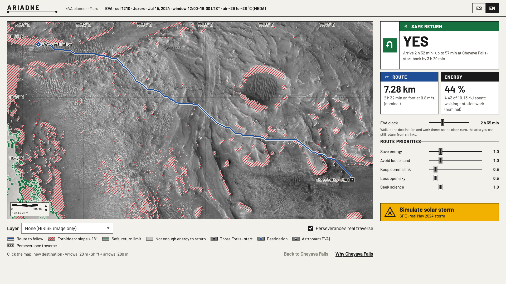
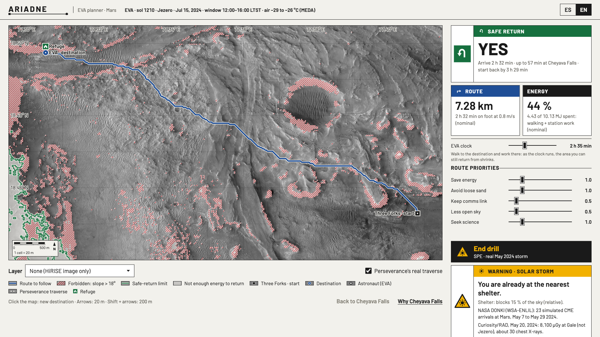

# ARIADNE

**ES** · [EN](#english)

> El control de misión de la EVA: dónde caminamos, si podemos volver y qué hacer si llega una tormenta solar.

Proyecto para el reto *Mars Surface Exploration Map* de NASA Space Apps 2026 ([`CHALLENGE.md`](CHALLENGE.md)). Una consola web, sin servidor y sin conexión, que funde capas de varias misiones de la NASA sobre el cráter Jezero y calcula en el navegador la ruta de un paseo espacial desde el depósito *Three Forks* hasta *Cheyava Falls*.




## Ejecutar

```bash
python3 -m http.server -d app/web 8000      # → http://localhost:8000
node app/web/pathfind.test.mjs              # tests del motor (Node 20 o superior)
```

Los datos ya están en `app/web/data/`. Para regenerarlos, ver [`app/README.md`](app/README.md). El idioma es español por defecto y se cambia a inglés con un clic.

## Cifras clave (ruta por defecto)

| | |
|---|---|
| Ruta | **7,28 km**, 2 h 32 min a pie a 0,8 m/s |
| ¿Volvemos? | **SÍ**: hasta **57 min** en el destino; hay que iniciar el regreso a las **3 h 29 min** de EVA |
| Energía | 4,36 MJ de marcha de un presupuesto de 10,13 MJ (8 h × 1200 BTU/h), con margen de retorno del 20 % (4,43 MJ en pantalla a las 2 h 35 min, con 3 min de trabajo en el destino) |
| Comunicaciones | Celdas de la ruta por defecto con enlace: 11 % sin repetidor, 82 % con el repetidor que coloca el algoritmo |
| Validación | **97,2 %** del recorrido real de Perseverance es transitable para el modelo; **r = 0,83** entre la pendiente del modelo y la inclinación medida por el rover en n = 357 waypoints |
| Sensibilidad | Con la base de la ISS (1000 BTU/h, 8,44 MJ) la respuesta por defecto sería **NO** |

## Cómo cubrimos el reto

| `CHALLENGE.md` | Qué hace ARIADNE |
|---|---|
| Vista en capas e integrada de una ruta o lugar | Una consola con HiRISE gris, ruta, perímetro de retorno y 8 capas conmutables sobre una malla común de 20 m |
| Al menos tres tipos de datos | Óptico (HiRISE), topográfico (DTM), térmico (THEMIS), espectral (CRISM), geológico (USGS), atmosférico (MEDA), radiación y clima espacial (DONKI, RAD) |
| Objetivo científico y lugar | Biofirma potencial en Cheyava Falls (Hurowitz et al. 2025), con la ruta inclinada por valor científico CRISM |
| Seguridad del astronauta, clima espacial y radiación | Simulacro de tormenta solar: camino al refugio más cercano entre el 5 % de celdas con menos cielo abierto, llegadas de CME a Marte (DONKI) y los 8.100 µGy medidos por Curiosity |
| Movilidad con traje y carga | Pandolf a 0,38 g con 80 kg + 50 kg de carga; el reloj de EVA y el perímetro de retorno se encogen con el gasto |
| Ruta que evite obstáculos | Pendientes de más de 18° prohibidas (rayado rojo), arena suelta penalizada con THEMIS, arena eólica mapeada con USGS |
| Imágenes POV de la llegada | Panorámica y fotos reales de Perseverance en el destino, con crédito |
| Condiciones actuales | Temperatura del aire medida por MEDA el sol 1210 y ventana de EVA |
| Herramientas que nombra el reto | Mars Trek (fondo HiRISE) y USGS Planetary Geologic Mapping (SIM 3464) |
| Formato: pantalla del hábitat, tableta o visor | Una consola de hábitat; la misma información se adaptaría a una tableta de muñeca y a un visor de casco |

## Datos

Todo se descarga antes y se guarda en `app/web/data/`; nada depende de la red durante la demo. Acreditación solo como fuente de datos, sin insignias de la NASA. ARIADNE es un proyecto de NASA Space Apps 2026; no está afiliado ni respaldado por la NASA.

| Conjunto | Crédito | Enlace |
|---|---|---|
| Fondo HiRISE 25 cm | NASA/JPL-Caltech/UArizona/USGS Astrogeology, vía NASA Mars Trek | doi:10.5066/P9QJDP48 |
| DTM HiRISE 1 m (elevación, pendiente, SVF, comunicaciones) | NASA/JPL-Caltech/USGS Astrogeology Science Center, Fergason et al. 2020 | doi:10.5066/P9REJ9JN |
| Inercia térmica THEMIS | NASA/JPL-Caltech/ASU, Mars Odyssey, USGS Astropedia | asc-astropedia.s3.us-west-2.amazonaws.com/Mars/Odyssey/THEMIS-Global-Thermal-Inertia-Mosaic/ |
| Minerales CRISM | Parente, Saranathan, Itoh y Tarnas (2021) | doi:10.5281/zenodo.5575824 |
| Geología, 7 unidades | Sun y Stack (2020), USGS SIM 3464 | doi:10.3133/sim3464 |
| Recorrido y waypoints de Perseverance | NASA/JPL-Caltech, Mars 2020 MMGIS | mars.nasa.gov/mmgis-maps/M20/Layers/json/M20_waypoints.json |
| Llegadas de CME a Marte, mayo de 2024 | NASA GSFC CCMC, DONKI (WSA-ENLIL; usada la simulación 30979) | ccmc.gsfc.nasa.gov/tools/DONKI/ |
| Dosis del 20 de mayo de 2024 (8.100 µGy, Gale) | NASA/JPL-Caltech, Curiosity RAD | nasa.gov, "NASA watches Mars light up during epic solar storm" |
| Aire y ventana de EVA, sol 1210 | Mars 2020 Perseverance MEDA (CAB/CAB-IAA), PDS Atmospheres Node, NMSU | atmos.nmsu.edu/PDS/data/PDS4/Mars2020/mars2020_meda/ |
| Ciencia del destino | Hurowitz et al. (2025), *Nature* 645, 332-340 | doi:10.1038/s41586-025-09413-0 |
| Fotos (PIA26369, PIA26401, PIA26370, PIA26368) | NASA/JPL-Caltech/ASU/MSSS (PIA26368: NASA/JPL-Caltech/MSSS); crédito, sol y fuente por foto en `pov.json` | photojournal.jpl.nasa.gov |

Capas calculadas por ARIADNE (exposición al cielo, comunicaciones, confianza, refugio, ruta, perímetro) están rotuladas como derivadas. Detalle y supuestos en [`app/README.md`](app/README.md) y [`ARIADNE.md`](ARIADNE.md).

## Límites honestos

- La radiación de la interfaz es **relativa** (factor de visión del cielo), no una dosis.
- Los 8.100 µGy los midió Curiosity en **Gale**, no en Jezero.
- Los parámetros del traje son **nominales** y están en `app/web/data/mission_config.json`, sin calibrar con datos reales de traje.
- El presupuesto de 10,13 MJ (1200 BTU/h) está citado; con la base de la ISS (8,44 MJ) la ruta por defecto no sería viable.
- La validación compara el terreno, no el traje; los waypoints no son independientes.
- El mapa geológico es regional (1:75.000) y anterior al aterrizaje, con posible desfase de 100–200 m. Three Forks es aproximado (±50 m).
- "Biofirma potencial" no es vida confirmada.

## Equipo

Raúl Vázquez Pérez, NachoASD y ccheerry (autores del repositorio).

## Licencia

MIT, ver [`LICENSE`](LICENSE). Datos y fotos pertenecen a sus autores; ver créditos arriba. Tipografía Barlow, SIL OFL 1.1.

Guion de la demo: [`docs/demo-script.md`](docs/demo-script.md).

---

## English

> EVA mission control: where do we walk, can we get back, and what if a solar storm hits.

Entry for NASA Space Apps 2026, *Mars Surface Exploration Map* ([`CHALLENGE.md`](CHALLENGE.md)). An offline web console, no server, that fuses layers from several NASA missions over Jezero crater and computes, in the browser, the route of a spacewalk from the *Three Forks* depot to *Cheyava Falls*.


### Run

```bash
python3 -m http.server -d app/web 8000      # → http://localhost:8000
node app/web/pathfind.test.mjs              # engine tests (Node 20 or newer)
```

The data is already in `app/web/data/`. To regenerate it, see [`app/README.md`](app/README.md). The UI is Spanish by default with a one-click switch to English.

### Key figures (default route)

| | |
|---|---|
| Route | **7.28 km**, 2 h 32 min on foot at 0.8 m/s |
| Can we get back? | **YES**: up to **57 min** at the destination; start back at **3 h 29 min** of EVA |
| Energy | 4.36 MJ spent walking out of a 10.13 MJ budget (8 h x 1200 BTU/h), 20% return margin (4.43 MJ on screen at 2 h 35 min, including 3 min of work at the destination) |
| Comms | Cells of the default route with a link: 11% without a relay, 82% with the relay the algorithm places |
| Validation | **97.2%** of Perseverance's real traverse is walkable for the model; **r = 0.83** between model slope and the tilt the rover measured at n = 357 waypoints |
| Sensitivity | On the ISS basis (1000 BTU/h, 8.44 MJ) the default answer would be **NO** |

### How we cover the challenge

| `CHALLENGE.md` | What ARIADNE does |
|---|---|
| Layered, integrated view of a route or place | One console: greyscale HiRISE, route, return envelope and 8 switchable layers on a common 20 m grid |
| At least three kinds of data | Optical (HiRISE), topographic (DTM), thermal (THEMIS), spectral (CRISM), geologic (USGS), atmospheric (MEDA), radiation and space weather (DONKI, RAD) |
| Science objective and location | Potential biosignature at Cheyava Falls (Hurowitz et al. 2025), with the route leaning on CRISM science value |
| Astronaut safety, space weather and radiation | Solar-storm drill: path to the nearest refuge among the 5% most sky-shielded cells, CME arrivals at Mars (DONKI) and the 8,100 µGy Curiosity measured |
| Mobility in a suit with a load | Pandolf at 0.38 g, 80 kg + 50 kg load; the EVA clock and the return envelope shrink with spent energy |
| Route that avoids obstacles | Slopes over 18 degrees forbidden (red hatch), loose sand penalised via THEMIS, aeolian sand mapped by USGS |
| POV images of the arrival | Real Perseverance panorama and photos at the destination, credited |
| Current conditions | Air temperature measured by MEDA on sol 1210 and an EVA window |
| Tools the challenge names | Mars Trek (HiRISE background) and the USGS Planetary Geologic Mapping Program (SIM 3464) |
| Format: habitat display, tablet or visor | A habitat console; the same information would adapt to a wrist tablet and a helmet visor |

### Data

Everything is downloaded ahead of time into `app/web/data/`; nothing needs the network during the demo. Credit as data source only, no NASA insignia. ARIADNE is a NASA Space Apps 2026 project; it is not affiliated with or endorsed by NASA. Credits and DOIs are in the [data table above](#datos); names and identifiers are language-neutral.

Layers computed by ARIADNE (sky exposure, comms, confidence, refuge, route, envelope) are labelled as derived. Details and assumptions in [`app/README.md`](app/README.md) and [`ARIADNE.md`](ARIADNE.md).

### Honest limits

- Radiation in the UI is **relative** (sky view factor), not a dose.
- The 8,100 µGy was measured by Curiosity at **Gale**, not at Jezero.
- Suit parameters are **nominal** (`app/web/data/mission_config.json`), not calibrated against real suit data.
- The 10.13 MJ budget (1200 BTU/h) is cited; on the ISS basis (8.44 MJ) the default route would not be viable.
- Validation checks the terrain, not the suit; waypoints are not independent.
- The geologic map is regional (1:75,000) and pre-landing, possibly offset by 100-200 m. Three Forks is approximate (±50 m).
- "Potential biosignature" is not confirmed life.

### Team

Raúl Vázquez Pérez, NachoASD and ccheerry (repository authors).

### Licence

MIT, see [`LICENSE`](LICENSE). Data and photos belong to their authors; see the credits above. Typeface Barlow, SIL OFL 1.1.

Demo script: [`docs/demo-script.md`](docs/demo-script.md).
