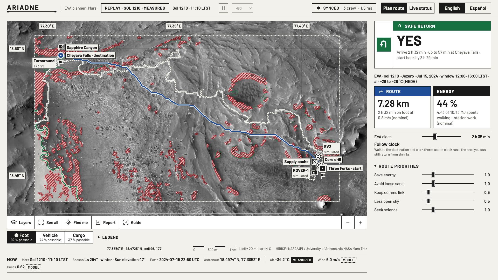

# ARIADNE

### ▶ [Open the live demo](https://ravazque.github.io/NASA-Space-APPs-Challenge_2026/) · [Dust-storm demo](https://ravazque.github.io/NASA-Space-APPs-Challenge_2026/?sim=storm_eva) · [Download the Android APK](https://github.com/ravazque/NASA-Space-APPs-Challenge_2026/releases/download/apk-latest/ariadne-debug.apk)

Runs in the browser, nothing to install. [Versión en español](https://ravazque.github.io/NASA-Space-APPs-Challenge_2026/?lang=es).

[](https://github.com/ravazque/NASA-Space-APPs-Challenge_2026/actions/workflows/android.yml)
[](https://ravazque.github.io/NASA-Space-APPs-Challenge_2026/)
[](https://github.com/ravazque/NASA-Space-APPs-Challenge_2026/releases/download/apk-latest/ariadne-debug.apk)
[](LICENSE)

**EN** · [ES](#español)

> An offline field network for a spacewalk on Mars: where do we walk, can we still get back, and what do we do if a dust storm arrives. Several devices, one shared plan, no internet.



Entry for NASA Space Apps 2026, *Mars Surface Exploration Map*. ARIADNE is not affiliated with or endorsed by NASA.

## Try it

| | |
|---|---|
| **Browser** | [Interactive demo](https://ravazque.github.io/NASA-Space-APPs-Challenge_2026/) (solo mode) |
| **Dust-storm demo** | [Simulated crew, rover and dust storm](https://ravazque.github.io/NASA-Space-APPs-Challenge_2026/?sim=storm_eva) (speed up the clock at the top to reach the storm sooner) |
| **Android** | [`ariadne-debug.apk`](https://github.com/ravazque/NASA-Space-APPs-Challenge_2026/releases/download/apk-latest/ariadne-debug.apk), rebuilt by CI on every push to `main` |
| **LAN, several devices** | `make up` on a laptop, then scan the QR it prints from phones on the same Wi-Fi |

## Why

A message takes 3 to 22 minutes between Mars and Earth, so a crew out on an EVA has to decide on its own. ARIADNE is the guide they would carry:

1. **Route.** The lowest-cost walking route for a suited astronaut at 0.38 g (Pandolf energy model), avoiding slopes over 18°, loose sand and large rocks, with a **safe-return limit** that shrinks as the EVA clock runs.
2. **Field network.** Phones, tablets and a laptop on the same Wi-Fi share one plan through a **hub**: ordered updates, leased locks on zones and equipment, and an append-only field log (fault, hazard, sample, deviation...) that **reroutes everyone else**. If the hub drops, devices keep working and catch up when it returns.
3. **Environment.** A Mars clock (NASA GISS Mars24) that replays a real Perseverance MEDA sol, 36 map layers in 6 categories and a dust-storm hazard. Every value is tagged `MEASURED`, `DERIVED`, `MODEL`, `SIMULATED` or `REPORTED`.

| Live status for the base | Layers |
|---|---|
|  |  |

| Phone | Guide mode |
|---|---|
|  |  |

## How it works

```
 Python pipeline (offline, once)        app/web (any browser or the APK)           app/hub (laptop on the LAN)
 ───────────────────────────────        ───────────────────────────────           ───────────────────────────
 NASA / USGS sources                    store.js  pub/sub state                   server.mjs  HTTP + WebSocket
   → rasterio windows                   pathfind.js  Dijkstra + MinHeap   ◄─ ws ─► single authority, seq ordering
   → 193 × 356 grid of 20 m cells       map.js  Leaflet 1.9.4, offline tiles      leases + fencing tokens
   → JSON + WebP in app/web/data        sync-core.js  shared reducer ◄──────────► same reducer, JSONL persistence
```

- **Frontend:** plain ES modules, no framework and no bundler. One store with publish/subscribe, every module exposes `init(ctx)`. Leaflet is vendored so the page works with no network.
- **Routing:** Dijkstra with a binary heap over 68,708 cells, cost layers kept in `Float32Array`s; about 30 ms for a full route on a laptop.
- **Sync:** the hub is the single source of order. Clients send operations with a client id for idempotency, the hub stamps a sequence number and broadcasts; both sides apply them with the same reducer (`sync-core.js`). Locks are leases with fencing tokens, so a device that comes back late cannot overwrite a newer holder.
- **Data pipeline:** Python 3 with `rasterio`, `numpy` and `pillow` reads only the windows it needs from remote GeoTIFFs and writes compact JSON and WebP that ship with the app.
- **Android:** the same `app/web` wrapped with Capacitor 7.
- **Tests:** Node's built-in `node:test`, unit tests plus an end-to-end test through a real hub on a free port.

```
app/web        the app (HTML, CSS, ES modules, data, offline tiles)
app/hub        LAN hub (Node 20, ws)
app/pipeline   scripts that download and prepare the NASA data
android        Capacitor Android project and icon generator
docs           screenshots and team logo
.github        CI: tests, APK build and release, GitHub Pages
```

## Quick start

Needs Node 20+ (and Python 3 for `make serve` or `make data`). `make help` lists everything:

```text
make up            install, test and start the hub (app + LAN sync + QR)   -> http://localhost:8090
make hub           start the hub only (TOKEN=secret protects the Base role)
make sim           hub + simulated crew, rover and dust storm (SIM=storm_eva)
make serve         app only on :8000, solo mode, no sync
make test          Node tests, about 15 s
make apk           build the debug Android APK (JDK 21 + Android SDK)
make data          rebuild data from NASA sources (needs network)
make tiles         download the HiRISE tiles z13 to z17
make clean         remove local envs and build outputs
make fclean        clean + downloads, tiles and caches (then: make data tiles)
```

The page is in English by default; switch with `EN | ES` in the header or `?lang=es`.

### Demo with one laptop

`make sim` runs a scenario with simulated astronauts, a rover, a weather change and a dust storm, all tagged `SIMULATED`:

1. `make sim`
2. Open `http://localhost:8090/?crew=EV1` and, next to it, `http://localhost:8090/?crew=BASE&role=base`.
3. EV2 reports a fault on the route and both windows reroute. Lock a zone in one window and watch it appear in the other with the measured latency. The afternoon wind raises a warning, then the dust storm jumps to danger and the NO-GO panel.

Without a hub, `?sim=storm_eva` runs the same scenario inside a single window.

### Android

CI builds a debug APK on every push and publishes it on the **Releases** page as `apk-latest`. To build it locally, install JDK 21 and the Android command-line tools (`brew install openjdk@21 && brew install --cask android-commandlinetools` on macOS, `jdk21-openjdk` plus the Android Studio SDK on Linux) and run `make apk`. Install with `adb install -r android/app/build/outputs/apk/debug/app-debug.apk`, then tap the sync chip in the app and enter the hub's `ip:port`.

The launcher icon is the team logo (`docs/brand/ariadne-logo.jpeg`); after changing it, run `python3 android/make_icon.py` (Pillow + numpy) to regenerate the `mipmap-*` icons. The web view sits below the status bar and notch (`adjustMarginsForEdgeToEdge` in `capacitor.config.json`).

## Zone

Jezero crater, 7.1 × 3.9 km (lon 77.295 to 77.415, lat 18.440 to 18.505). The default EVA goes from the *Three Forks* sample depot to *Cheyava Falls*, where Perseverance found a potential biosignature (not confirmed life): 7.28 km, about 2 h 32 min on foot.

## Data sources

Everything is downloaded ahead of time and committed. The running app makes no network calls except the WebSocket to your own hub. Only DONKI needs a key: `NASA_API_KEY` in `app/.env` (git-ignored, falls back to `DEMO_KEY`).

| Source | For |
|---|---|
| NASA Mars Trek WMTS, HiRISE 25 cm mosaic | Offline basemap |
| USGS Astrogeology HiRISE DTM and THEMIS | Elevation, slope, relief, thermal inertia |
| USGS SIM 3464 (ArcGIS FeatureServer) | Geologic units |
| CRISM mineral map (Zenodo 5575824) | Minerals, science score |
| Mars 2020 MMGIS waypoints | Real Perseverance traverse, used to validate routes |
| NASA DONKI | CME arrivals at Mars, May 2024 |
| PDS Atmospheres Node, MEDA | Pressure, temperature, humidity and wind for 14 sols |
| NASA Images API / Photojournal | Destination photos |
| NASA GISS Mars24 | Mars clock (algorithm, no call) |

Limits: radiation in the plan is relative; the 8,100 µGy dose was measured at Gale, not Jezero; suit parameters are nominal; the geologic map is regional and pre-landing.

## Team and licence

Raúl Vázquez Pérez ([@ravazque](https://github.com/ravazque)), [@NachoASD](https://github.com/NachoASD), [@ccheerry](https://github.com/ccheerry), [@ptrapero](https://github.com/ptrapero) and [@RaulMkn](https://github.com/RaulMkn).

MIT, see [`LICENSE`](LICENSE). Data and photos belong to their authors (credits in the app footer). Barlow typeface under SIL OFL 1.1, Leaflet 1.9.4 under BSD-2.

---

## Español

**ARIADNE** es una red de campo sin internet para un paseo espacial en Marte: por dónde caminar, si todavía podemos volver y qué hacer si llega una tormenta de polvo. Varios dispositivos comparten un mismo plan. Proyecto para el reto *Mars Surface Exploration Map* de NASA Space Apps 2026; no está afiliado ni respaldado por la NASA.

- **Probarlo.** En el navegador: [demo en GitHub Pages](https://ravazque.github.io/NASA-Space-APPs-Challenge_2026/?lang=es) o [demo con tormenta de polvo simulada](https://ravazque.github.io/NASA-Space-APPs-Challenge_2026/?sim=storm_eva&lang=es). En Android: [descargar el APK](https://github.com/ravazque/NASA-Space-APPs-Challenge_2026/releases/download/apk-latest/ariadne-debug.apk). En red local: `make up` en un portátil y escanear el QR desde los móviles.
- **Ruta.** Calcula la ruta de menor coste para un astronauta con traje a 0,38 g, evitando pendientes de más de 18°, arena suelta y rocas grandes, con un límite de retorno seguro que se reduce con el reloj de la EVA.
- **Red de campo.** Un hub en la red local ordena las operaciones, gestiona bloqueos con arrendamiento y guarda un registro de campo compartido que recalcula la ruta de los demás. Si el hub cae, los dispositivos siguen funcionando y se ponen al día al volver.
- **Entorno.** Reloj marciano Mars24 que reproduce un sol real medido por MEDA, 36 capas en 6 categorías y peligro de tormenta de polvo. Cada dato lleva su etiqueta de origen.
- **Stack.** JavaScript con módulos ES sin framework ni bundler, Leaflet, hub en Node con WebSocket, pipeline de datos en Python y APK con Capacitor. Tests con `node:test` y CI en GitHub Actions.
- **Comandos.** `make help` los lista todos; `make sim` simula tripulación, rover y tormenta con un solo portátil; `make test` pasa los tests; `make apk` compila el APK.
- **Equipo.** Raúl Vázquez Pérez (@ravazque), @NachoASD, @ccheerry, @ptrapero y @RaulMkn. Licencia MIT.
