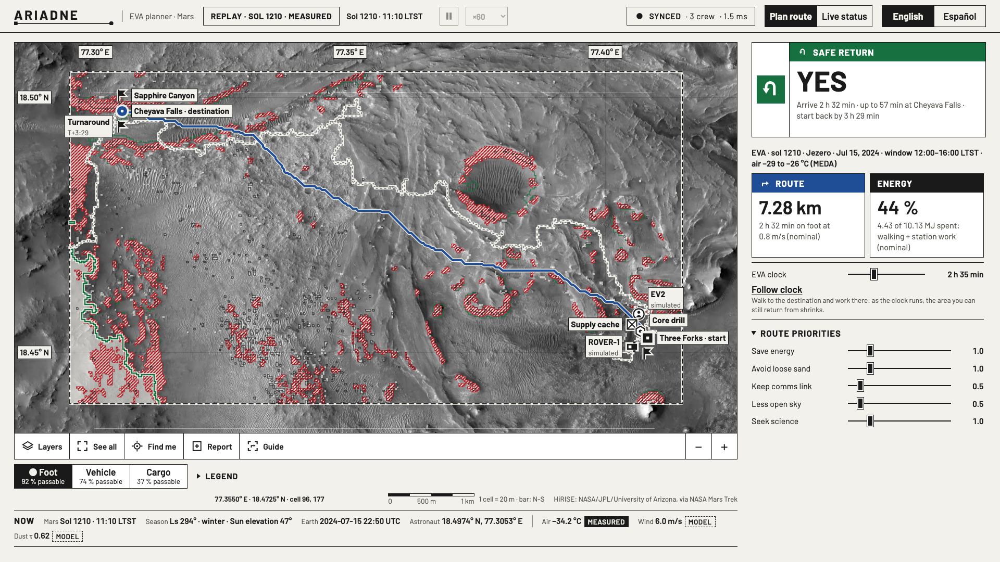
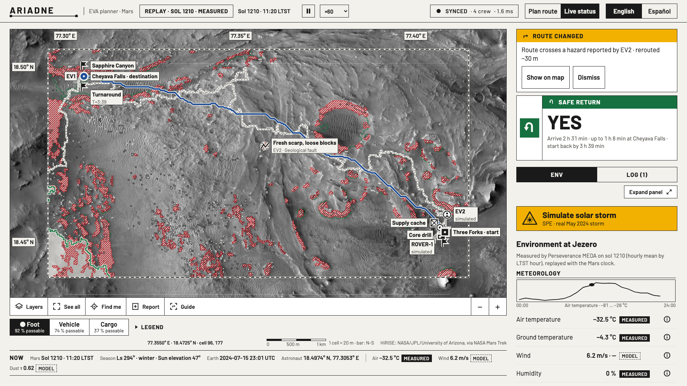
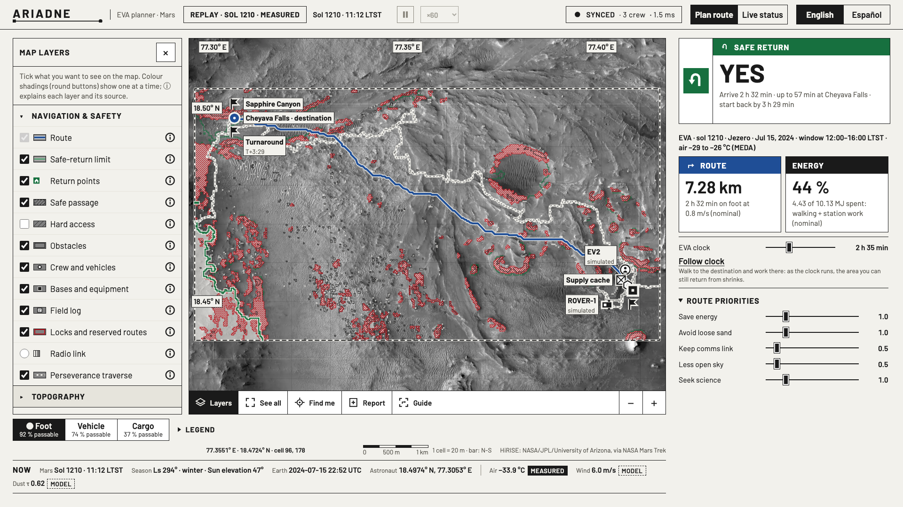
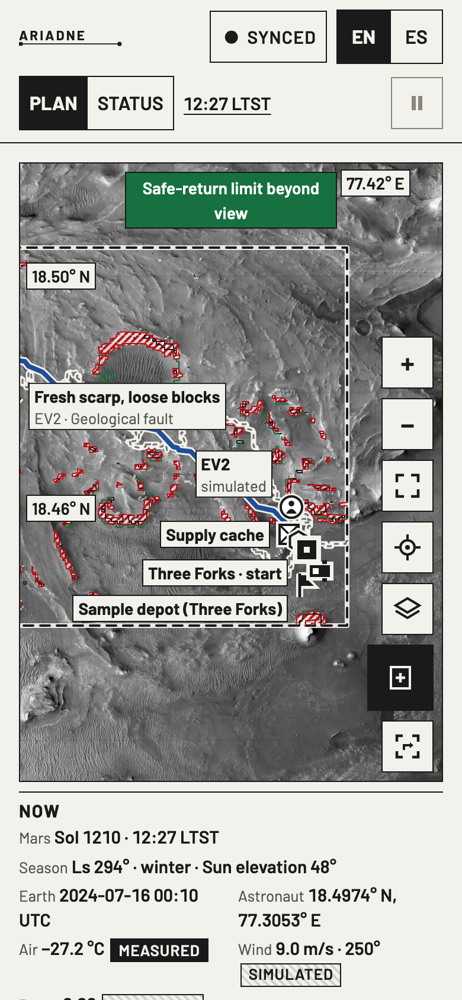
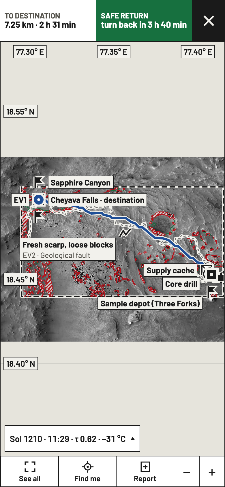

# ARIADNE

### [Abrir la demo](https://ravazque.github.io/NASA-2026/?lang=es) · [Demo con tormenta de polvo](https://ravazque.github.io/NASA-2026/?sim=storm_eva&lang=es) · [Descargar el APK para Android](https://github.com/ravazque/NASA-Space-APPs-Challenge_2026/releases/latest/download/ariadne-debug.apk)

Funciona en el navegador, sin instalar nada. [English version](../README.md).

[](https://github.com/ravazque/NASA-Space-APPs-Challenge_2026/actions/workflows/android.yml)
[](https://ravazque.github.io/NASA-2026/?lang=es)
[](https://github.com/ravazque/NASA-Space-APPs-Challenge_2026/releases/latest/download/ariadne-debug.apk)
[](../LICENSE)

[EN](../README.md) · **ES**

> Una red de campo que funciona sin conexión para un paseo espacial en Marte: por dónde caminar, si todavía podemos volver y qué hacer si llega una tormenta de polvo. Varios dispositivos, un plan compartido, sin internet.



Proyecto para NASA Space Apps 2026, reto *Mars Surface Exploration Map*. ARIADNE no está afiliado ni respaldado por la NASA.

## Probarlo

| | |
|---|---|
| **Navegador** | [Demo interactiva](https://ravazque.github.io/NASA-2026/?lang=es) (modo individual) |
| **Demo con tormenta de polvo** | [Tripulación, rover y tormenta de polvo simulados](https://ravazque.github.io/NASA-2026/?sim=storm_eva&lang=es) (acelera el reloj de arriba para llegar antes a la tormenta) |
| **Android** | [`ariadne-debug.apk`](https://github.com/ravazque/NASA-Space-APPs-Challenge_2026/releases/latest/download/ariadne-debug.apk) de la última versión publicada, o [`apk-latest`](https://github.com/ravazque/NASA-Space-APPs-Challenge_2026/releases/tag/apk-latest) con la compilación más reciente de `main` |
| **Red local, varios dispositivos** | `make up` en un portátil y escanea el QR que imprime desde móviles en la misma wifi |

## Por qué

Un mensaje tarda entre 3 y 22 minutos en ir de Marte a la Tierra, así que una tripulación en plena EVA tiene que decidir por su cuenta. ARIADNE es la guía que llevaría consigo:

1. **Ruta.** La ruta a pie de menor coste para un astronauta con traje a 0,38 g (modelo energético de Pandolf), evitando pendientes de más de 18°, arena suelta y rocas grandes, con un **límite de retorno seguro** que se reduce a medida que avanza el reloj de la EVA.
2. **Red de campo.** Móviles, tabletas y un portátil en la misma wifi comparten un plan a través de un **hub**: actualizaciones ordenadas, bloqueos con arrendamiento (leases) sobre zonas y equipo, y un registro de campo en el que solo se añade (avería, peligro, muestra, desvío...) y que **recalcula la ruta de todos los demás**. Si el hub se cae, los dispositivos siguen funcionando y se ponen al día cuando vuelve.
3. **Entorno.** Un reloj marciano (NASA GISS Mars24) que reproduce un sol real medido por MEDA en Perseverance, 36 capas de mapa en 6 categorías y el peligro de tormenta de polvo. Cada valor lleva su etiqueta de origen: `MEASURED`, `DERIVED`, `MODEL`, `SIMULATED` o `REPORTED`.

| Estado en vivo para la base | Capas |
|---|---|
|  |  |

| Móvil | Modo guía |
|---|---|
|  |  |

## Cómo funciona

```
 Python pipeline (offline, once)        app/web (any browser or the APK)           app/hub (laptop on the LAN)
 ───────────────────────────────        ───────────────────────────────           ───────────────────────────
 NASA / USGS sources                    store.js  pub/sub state                   server.mjs  HTTP + WebSocket
   → rasterio windows                   pathfind.js  Dijkstra + MinHeap   ◄─ ws ─► single authority, seq ordering
   → 193 × 356 grid of 20 m cells       map.js  Leaflet 1.9.4, offline tiles      leases + fencing tokens
   → JSON + WebP in app/web/data        sync-core.js  shared reducer ◄──────────► same reducer, JSONL persistence
```

- **Frontend:** módulos ES, sin framework ni bundler. Un único store con publicación/suscripción; cada módulo expone `init(ctx)`. Leaflet va incluido en el repositorio para que la página funcione sin red.
- **Rutas:** Dijkstra con un montículo binario sobre 68.708 celdas, con las capas de coste en `Float32Array`; unos 30 ms por ruta completa en un portátil.
- **Sincronización:** el hub es la única fuente de orden. Los clientes envían operaciones con un id de cliente para que sean idempotentes, el hub les asigna un número de secuencia y las difunde, y ambos lados las aplican con el mismo reducer (`sync-core.js`). Los bloqueos son leases con fencing tokens, así que un dispositivo que vuelve tarde no puede sobrescribir a un titular más reciente.
- **Pipeline de datos:** Python 3 con `rasterio`, `numpy` y `pillow` lee solo las ventanas que necesita de GeoTIFF remotos y escribe JSON y WebP compactos que se distribuyen con la app.
- **Android:** el mismo `app/web` empaquetado con Capacitor 7.
- **Tests:** `node:test`, el que trae Node de serie: tests unitarios y un test de extremo a extremo contra un hub real en un puerto libre.

```
app/web        la app (HTML, CSS, módulos ES, datos, teselas offline)
app/hub        hub de la red local (Node 20, ws)
app/pipeline   scripts que descargan y preparan los datos de la NASA
android        proyecto Android de Capacitor y generador del icono
docs           este README, capturas y logo del equipo
.github        CI: tests, compilación y publicación del APK, GitHub Pages
```

## Inicio rápido

Necesita Node 20+ (y Python 3 para `make serve` o `make data`). `make help` lo lista todo:

```text
make up            instala, pasa los tests y arranca el hub (app + sincronización + QR)   -> http://localhost:8090
make hub           arranca solo el hub (TOKEN=secreto protege el rol Base)
make sim           hub + tripulación, rover y tormenta de polvo simulados (SIM=storm_eva)
make serve         solo la app en :8000, modo individual, sin sincronización
make test          tests de Node, unos 15 s
make apk           compila el APK de depuración para Android (JDK 21 + Android SDK)
make data          regenera los datos desde las fuentes de la NASA (necesita red)
make tiles         descarga las teselas HiRISE de z13 a z17
make clean         borra los entornos locales y lo compilado
make fclean        clean + descargas, teselas y cachés (después: make data tiles)
```

La página está en inglés por defecto; se cambia con `EN | ES` en la cabecera o con `?lang=es`.

### Demo con un solo portátil

`make sim` ejecuta un escenario con astronautas simulados, un rover, un cambio de tiempo y una tormenta de polvo, todo etiquetado como `SIMULATED`:

1. `make sim`
2. Abre `http://localhost:8090/?crew=EV1` y, al lado, `http://localhost:8090/?crew=BASE&role=base`.
3. EV2 informa de una avería en la ruta y las dos ventanas recalculan la ruta. Bloquea una zona en una ventana y mira cómo aparece en la otra con la latencia medida. El viento de la tarde lanza un aviso; después la tormenta de polvo salta a peligro y aparece el panel NO-GO.

Sin hub, `?sim=storm_eva` ejecuta el mismo escenario dentro de una sola ventana.

### Android

La CI compila un APK de depuración en cada push y publica el de `main` en la página **Releases** como la pre-release `apk-latest`; al subir una etiqueta `v*` se publica una versión numerada con su propio APK. Para compilarlo en local, instala JDK 21 y las herramientas de línea de comandos de Android (`brew install openjdk@21 && brew install --cask android-commandlinetools` en macOS, `jdk21-openjdk` más el SDK de Android Studio en Linux) y ejecuta `make apk`. Instálalo con `adb install -r android/app/build/outputs/apk/debug/app-debug.apk`; después toca el indicador de sincronización de la app e introduce el `ip:puerto` del hub.

El icono de la app es el logo del equipo (`docs/brand/ariadne-logo.jpeg`); si lo cambias, ejecuta `python3 android/make_icon.py` (Pillow + numpy) para regenerar los iconos `mipmap-*`. La vista web queda por debajo de la barra de estado y del notch (`adjustMarginsForEdgeToEdge` en `capacitor.config.json`).

## Zona

Cráter Jezero, 7,1 × 3,9 km (lon 77,295 a 77,415, lat 18,440 a 18,505). La EVA por defecto va del depósito de muestras *Three Forks* a *Cheyava Falls*, donde Perseverance encontró una posible biofirma (no es vida confirmada): 7,28 km, unas 2 h 32 min a pie.

## Fuentes de datos

Todo se descarga de antemano y está en el repositorio. La app en marcha no hace ninguna llamada de red salvo el WebSocket a tu propio hub. Solo DONKI necesita clave: `NASA_API_KEY` en `app/.env` (ignorado por git; si no está, usa `DEMO_KEY`).

| Fuente | Para |
|---|---|
| NASA Mars Trek WMTS, mosaico HiRISE de 25 cm | Mapa base sin conexión |
| USGS Astrogeology HiRISE DTM y THEMIS | Elevación, pendiente, relieve, inercia térmica |
| USGS SIM 3464 (ArcGIS FeatureServer) | Unidades geológicas |
| Mapa mineral CRISM (Zenodo 5575824) | Minerales, puntuación científica |
| Waypoints MMGIS de Mars 2020 | Recorrido real de Perseverance, para validar las rutas |
| NASA DONKI | Llegadas de CME a Marte, mayo de 2024 |
| PDS Atmospheres Node, MEDA | Presión, temperatura, humedad y viento de 14 soles |
| NASA Images API / Photojournal | Fotos de los destinos |
| NASA GISS Mars24 | Reloj marciano (algoritmo, sin llamadas) |

Límites: la radiación del plan es relativa; la dosis de 8.100 µGy se midió en Gale, no en Jezero; los parámetros del traje son nominales; el mapa geológico es regional y anterior al aterrizaje.

## Equipo y licencia

Raúl Vázquez Pérez ([@ravazque](https://github.com/ravazque)), [@NachoASD](https://github.com/NachoASD), [@ccheerry](https://github.com/ccheerry), [@ptrapero](https://github.com/ptrapero) y [@RaulMkn](https://github.com/RaulMkn).

MIT, ver [`LICENSE`](../LICENSE). Los datos y las fotos pertenecen a sus autores (créditos en el pie de la app). Tipografía Barlow bajo SIL OFL 1.1, Leaflet 1.9.4 bajo BSD-2.
